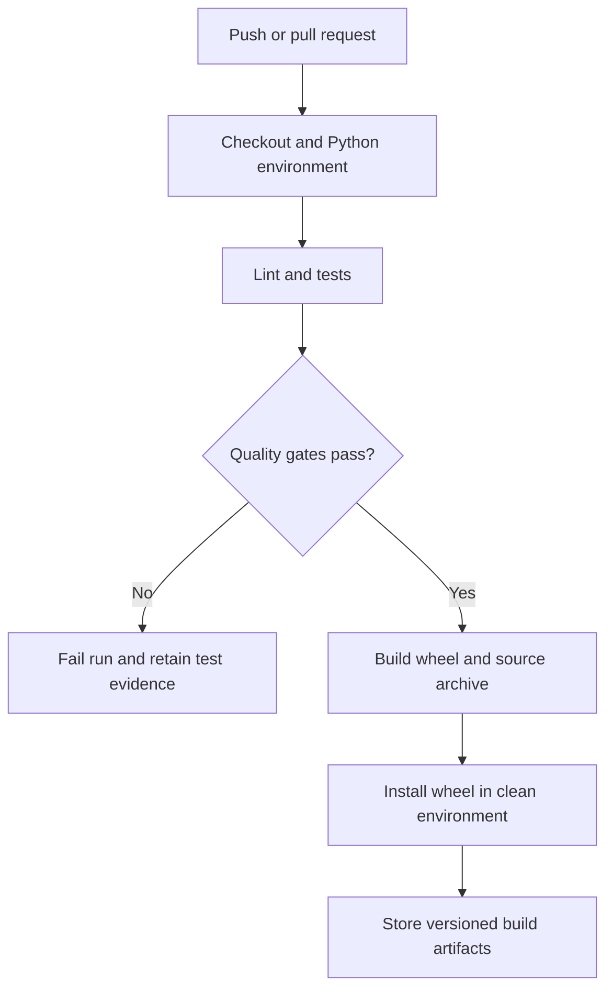

# EngiTest CI

**Automated Testing & CI/CD Pipeline for Engineering Software**

A small Python engineering package whose main deliverable is reproducible software
quality evidence: numerical tests, boundary validation, a built wheel, isolated
installation smoke checks, GitHub Actions and a comparable Jenkinsfile.

Independent portfolio project; no Siemens Gamesa endorsement or enterprise Jenkins /
Artifactory deployment is claimed. This repository intentionally has no artificial web app.

## Engineering functions

| Function | Contract and output |
|---|---|
| `wind_power(v, r, rho, Cp)` | `0.5 × rho × πr² × v³ × Cp`, watts; Cp ≤ 16/27 |
| `controller_error(expected, actual)` | Absolute percentage error; 0/0 → 0; nonzero/0 rejected |
| `efficiency(output, input)` | Percent; passive device, 0 ≤ output ≤ input and input > 0 |
| `tip_speed_ratio(rpm, r, wind)` | `(rpm × 2π/60) × r / wind`, dimensionless |
| `temperature_conversion(value, source, target)` | C/F/K, never below absolute zero |
| `tolerance_check(expected, actual, pct, zero_tolerance)` | Inclusive relative/absolute boundary |
| `validate_measurement(value, minimum, maximum)` | Finite number in inclusive range |

Wind power assumes steady uniform flow and a constant power coefficient. It does
not apply a rated-power cap or drivetrain losses. These are transparent teaching
calculations, not a validated turbine design tool. Inputs reject booleans, NaN,
infinity, invalid units and physically invalid domains. `MeasurementRange` provides
an immutable reusable OOP contract. Arithmetic overflow is reported as `ValueError`.

## Run locally

Python 3.11 or 3.12 is recommended. From this repository's root:

```bash
python -m venv .venv
```

Activate with `.venv\Scripts\Activate.ps1` in Windows PowerShell, or
`source .venv/bin/activate` on macOS/Linux, then:

```bash
python -m pip install -r requirements-dev.txt
python -m pytest
```

Runtime dependencies are specified in `pyproject.toml`. `requirements.txt`
installs the local package; `requirements-dev.txt` also installs test/build tools.
No secrets or paid services are required for local use.

```bash
python -m engitest
python -m pytest --cov=engitest --cov-branch --cov-fail-under=90 --cov-report=term-missing --cov-report=xml --junitxml=test-results/junit.xml
python -m build
python scripts/smoke_wheel.py
```

The smoke script installs the actual wheel into a new temporary environment outside
the checkout, then verifies imports and known numerical output. It catches missing
package files that running tests against source alone might miss.

## CI/CD architecture



`.github/workflows/ci.yml` runs Linux Python 3.11/3.12 and Windows Python 3.12.
It publishes JUnit and coverage evidence even when tests fail. Package artifacts
upload only after the build and isolated smoke check pass. A 90% branch-inclusive
coverage gate applies. No package is automatically published to PyPI or production.
This implements continuous integration and artifact delivery; production promotion
would be a separate authorized release step.

For visible recruiter evidence, open the **Actions** tab, select **Engineering CI**,
and inspect the run attached to the current main commit. Download its test-evidence
or package artifact (GitHub may require sign-in for artifact downloads).
`VERIFICATION.md` distinguishes local evidence from actual remote CI status.

## Test strategy

- Unit and inclusive boundary checks for the public API.
- Regression fixtures with independently calculated numerical expectations.
- Physical invariants: doubling wind speed gives eight times the power; doubling
  radius gives four times the power under this simplified model.
- Invalid inputs, undefined divisions, non-finite values and overflow.
- CLI JSON and installed-wheel checks.

## Jenkins

`Jenkinsfile` provides checkout, isolated environment, lint/tests, build, installed-wheel
verification, JUnit collection and fingerprinted artifacts. It expects a Linux agent
with Python 3.11+ and Jenkins Pipeline/JUnit plugins. Create a Pipeline from SCM
pointed at this repository. It is supplied as configuration; an actual Jenkins run
is not claimed unless separately recorded in `VERIFICATION.md`.

## Where Artifactory fits

After the smoke check, a production team could publish the wheel and source archive
to an authenticated Artifactory Python repository, keyed to version and commit SHA.
Credentials belong in Jenkins credentials or GitHub Actions secrets. Retention,
promotion and release approval policies would sit at this artifact boundary.
No Artifactory server, upload or credential is included or claimed here.

## Project layout

`src/engitest` contains the package; `tests` contains numerical and regression tests;
`scripts/smoke_wheel.py` verifies packaging; `.github/workflows/ci.yml` and `Jenkinsfile`
provide the two CI definitions. Next extensions could be golden-file regression
datasets and versioned release promotion, once a real deployment target exists.
